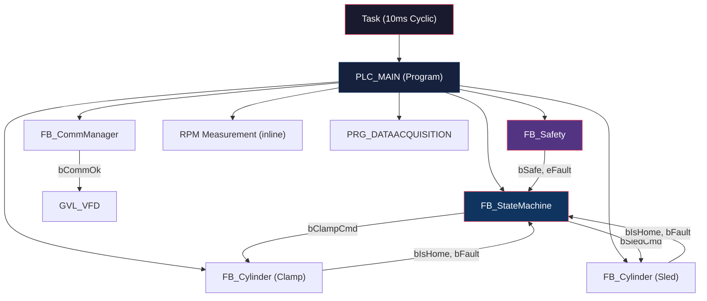
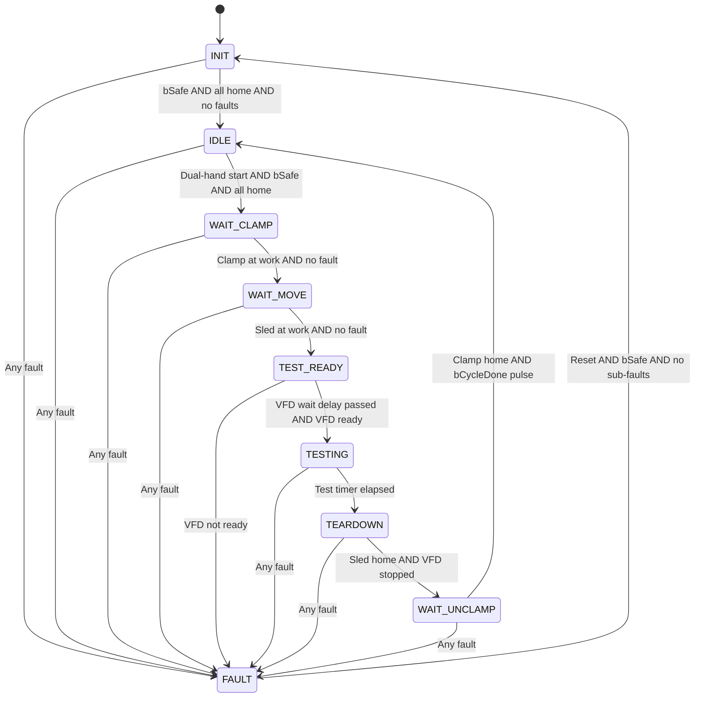
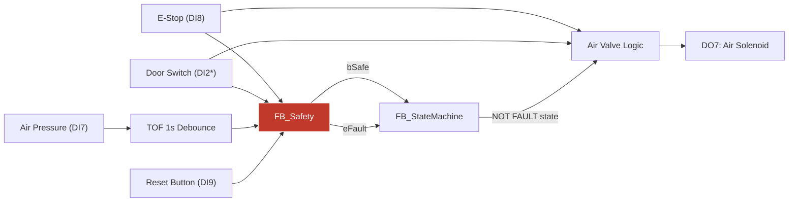

# BACK-EMF MOTOR TESTER — COMMISSIONING & ENGINEERING DOCUMENTATION

**Project Name:** BACKEMFTESTER  
**Platform:** ABB AC500 V3 — PM5032-T-ETH  
**IDE:** Automation Builder 2.8 — Basic  
**Document Revision:** 1.0  
**Date:** 2026-06-28  
**Status:** Ready for Commissioning

---

> [!CAUTION]
> **This is a SAFETY-CRITICAL machine.** The system controls pneumatic clamps, a sliding mechanism, and a VFD-driven motor. Improper commissioning can result in **injury or equipment damage**. Read this document in its entirety before powering on.

---

## Table of Contents

1. [System Overview](#1-system-overview)
2. [Hardware Configuration](#2-hardware-configuration)
3. [I/O Wiring Map](#3-io-wiring-map)
4. [Software Architecture](#4-software-architecture)
5. [Global Variable Lists (GVLs)](#5-global-variable-lists-gvls)
6. [Enumerations](#6-enumerations)
7. [Data Structures](#7-data-structures)
8. [Function Block Reference](#8-function-block-reference)
9. [State Machine — Complete Sequence of Operation](#9-state-machine--complete-sequence-of-operation)
10. [Safety System](#10-safety-system)
11. [VFD Modbus Communication (FB_CommManager)](#11-vfd-modbus-communication-fb_commmanager)
12. [RPM Measurement System](#12-rpm-measurement-system)
13. [Data Acquisition System (PRG_DATAACQUISITION)](#13-data-acquisition-system-prg_dataacquisition)
14. [HMI / Modbus Register Map](#14-hmi--modbus-register-map)
15. [Fault Reference Table](#15-fault-reference-table)
16. [Configurable Parameters](#16-configurable-parameters)
17. [Commissioning Procedure](#17-commissioning-procedure)
18. [Troubleshooting Guide](#18-troubleshooting-guide)

---

## 1. System Overview

### Purpose

The **Back-EMF Tester** is an automated test station that measures the **back-electromotive force (back-EMF)** of electric motors. It performs a complete test cycle:

1. Clamps the Device Under Test (DUT) motor
2. Extends a mechanical sled to engage the coupling
3. Spins the motor at a commanded RPM via a VFD (Variable Frequency Drive)
4. Captures 3-phase back-EMF voltages (U-V, V-W, W-U) at 100ms sample intervals
5. Records peak voltages, live voltages, and RPM telemetry
6. Exports results to HMI for CSV extraction
7. Returns to idle for the next DUT

### Key Features (Fully Implemented)

| Feature | Status |
|---|---|
| 9-state sequential state machine | ✅ Fully Implemented |
| Dual-hand start (anti-tie-down) | ✅ Fully Implemented |
| Safety interlock system (E-Stop, Door, Air) | ✅ Fully Implemented |
| Dual clamp sensor support (Clamp + Clamp2) | ✅ Fully Implemented |
| Pneumatic cylinder control with timeout supervision | ✅ Fully Implemented |
| Sled coupling wiggle alignment routine | ✅ Fully Implemented |
| VFD Modbus TCP communication (ETHx_MOD_MAST) | ✅ Fully Implemented |
| VFD speed/accel/decel parameter writes on-demand | ✅ Fully Implemented |
| Hardware counter RPM measurement (6-tooth gear, 100ms window) | ✅ Fully Implemented |
| 3-phase analog voltage scaling (0–150V) | ✅ Fully Implemented |
| Peak voltage capture during test | ✅ Fully Implemented |
| 100ms data logging to sample buffer (up to 1000 samples) | ✅ Fully Implemented |
| HMI Modbus register map with telemetry | ✅ Fully Implemented |
| HMI heartbeat watchdog | ✅ Fully Implemented |
| Retained cycle counter (power-safe) | ✅ Fully Implemented |
| CSV export / Clear log pulse signals to HMI | ✅ Fully Implemented |
| 16 enumerated fault codes with latching | ✅ Fully Implemented |
| VFD communication loss detection (10-strike) | ✅ Fully Implemented |
| VFD ready-loss and run-check monitoring | ✅ Fully Implemented |
| State timeout watchdog (30s default) | ✅ Fully Implemented |
| Air pressure debounce (1s TOF) | ✅ Fully Implemented |
| Fault-state safe retract logic (spindle-aware) | ✅ Fully Implemented |

---

## 2. Hardware Configuration

### PLC

| Parameter | Value |
|---|---|
| **CPU Model** | ABB PM5032-T-ETH |
| **Device Type** | 4096 |
| **Device ID** | 1020 0723 |
| **Firmware Version** | 3.8.1.0 |
| **Onboard I/O** | 12 DI / 8 DOT (transistor) / 2 DC (configurable) |
| **Ethernet Ports** | Built-in (ETH1 used for VFD Modbus TCP) |

### Task Configuration

| Parameter | Value |
|---|---|
| **Task Name** | Task |
| **Cycle Time** | 10 ms (`PT0.01S`) |
| **Priority** | 14 |
| **Watchdog Enabled** | Yes |
| **Watchdog Time** | 20 ms |
| **Sensitivity** | 1 |
| **Main POU** | `PLC_MAIN` |

### Required Libraries

| Library | Namespace | Purpose |
|---|---|---|
| Standard 3.5.18.0 | Standard | TON, TOF, R_TRIG standard function blocks |
| IoStandard 3.5.17.0 | IoStandard | I/O driver framework |
| Ethernet 1.5.1.4 (ABB) | AC500_Ethernet | Ethernet TCP/IP stack |
| ModbusTcp (ABB) | AC500_ModbusTcp | ETHx_MOD_MAST function block |
| OnboardIO 1.0.9.11 (ABB) | AC500_OnboardIO | OBIOForwardCounter for RPM |
| IoDrvOnboardIO 1.0.10.5 (ABB) | AC500_IoDrvOnboardIO | Onboard I/O driver |
| SysTime 3.5.17.0 | SysTime | `SysTimeGetMs()` for RPM timing |
| Util (System) | Util | Utility functions |
| Pm 1.2.10.8 (ABB) | AC500_Pm | Process management |
| DiagTypes 1.2.8.3 (ABB) | AC500_DiagTypes | Diagnostic types |
| DiagCpu 1.2.4.4 (ABB) | AC500_DiagCpu | CPU diagnostics |

---

## 3. I/O Wiring Map

### Digital Inputs — 24VDC

| Terminal | PLC Address | GVL Variable | Signal Description | Sensor Type |
|---|---|---|---|---|
| **DI0** | Fast Input 0 | `GVL_IO.bBtnLeft` | Left hand start button | Momentary NO pushbutton |
| **DI1** | Fast Input 1 | `GVL_IO.bBtnRight` | Right hand start button | Momentary NO pushbutton |
| **DI2** | Fast Input 2 | `GVL_IO.bClampWork` | Clamp 1 — Extended (work) position sensor | Proximity / Reed switch |
| **DI3** | Fast Input 3 | `GVL_IO.bClampHome` | Clamp 1 — Retracted (home) position sensor | Proximity / Reed switch |
| **DI4** | Fast Input 4 | `GVL_IO.bRPMPulse` | RPM pulse input (6 teeth/rev) | Proximity sensor on gear |
| **DI5** | Fast Input 5 | `GVL_IO.bSledWork` | Sled extended (work) position sensor | Proximity / Reed switch |
| **DI6** | Fast Input 6 | `GVL_IO.bSledHome` | Sled retracted (home) position sensor | Proximity / Reed switch |
| **DI7** | Fast Input 7 | `GVL_IO.bAirPressOK` | Air pressure switch (TRUE = above threshold) | Pressure switch |
| **DI8** | Standard Input 8 | `GVL_IO.bEStopOK` | E-Stop relay OK (TRUE = safe, circuit healthy) | NC relay contact |
| **DI9** | Standard Input 9 | `GVL_IO.bBtnReset` | Reset pushbutton | Momentary NO pushbutton |
| **DI10** | Standard Input 10 | `GVL_IO.bClamp2Home` | Clamp 2 — Retracted (home) position sensor | Proximity / Reed switch |
| **DI11** | Standard Input 11 | `GVL_IO.bVfdRunningFb` | VFD Running feedback (hardwired relay) | VFD relay output |
| **DC12** | Config Input 12 | `GVL_IO.bVFDHealthyFb` | VFD Healthy / Ready feedback (hardwired) | VFD relay output |
| **DC13** | Config Input 13 | `GVL_IO.bClamp2Work` | Clamp 2 — Extended (work) position sensor | Proximity / Reed switch |

> [!IMPORTANT]
> **DI4 (RPM Pulse)** is configured as a **Forward Counter** channel (up to 100 kHz). This must remain configured in the Automation Builder I/O tree as `Forward Counter Channel 0` for the `OBIOForwardCounter` FB to work correctly.

> [!IMPORTANT]
> **DC12 and DC13** are configured as **Inputs** (parameter value = 10 in their channel configuration). If reconfigured as outputs, the VFD healthy feedback and Clamp2Work signals will be lost.

### Digital Outputs — 24VDC / 0.5A Transistor

| Terminal | PLC Address | GVL Variable | Signal Description | Actuator |
|---|---|---|---|---|
| **DO0** | Fast Output 0 | `GVL_IO.bDriveRun` | VFD Run command | VFD digital input (Run) |
| **DO1** | Fast Output 1 | `GVL_IO.bDriveJogFwd` | VFD Jog Forward command | VFD digital input (Jog Fwd) |
| **DO2** | Fast Output 2 | `GVL_IO.bDriveJogRev` | VFD Jog Reverse command | VFD digital input (Jog Rev) |
| **DO3** | Fast Output 3 | `GVL_IO.bValveClampFwd` | Clamp — Extend solenoid | 24V solenoid valve |
| **DO4** | Fast Output 4 | `GVL_IO.bValveClampRev` | Clamp — Retract solenoid | 24V solenoid valve |
| **DO5** | Fast Output 5 | `GVL_IO.bValveSledFwd` | Sled — Extend solenoid | 24V solenoid valve |
| **DO6** | Fast Output 6 | `GVL_IO.bValveSledRev` | Sled — Retract solenoid | 24V solenoid valve |
| **DO7** | Fast Output 7 | `GVL_IO.bAirValveCmd` | Main air supply solenoid valve | 24V solenoid valve |

### Analog Inputs (External Module — Mapped to GVL_DACQ)

| Channel | GVL Variable | Signal | Range |
|---|---|---|---|
| AI0 | `GVL_DACQ.g_iAI_UV_Raw` | Phase U-V voltage (via transmitter) | 0–27648 counts → 0–150V |
| AI1 | `GVL_DACQ.g_iAI_VW_Raw` | Phase V-W voltage (via transmitter) | 0–27648 counts → 0–150V |
| AI2 | `GVL_DACQ.g_iAI_WU_Raw` | Phase W-U voltage (via transmitter) | 0–27648 counts → 0–150V |

> [!NOTE]
> The analog scaling formula is: `Voltage = (RawCounts / 27648) × 150.0 V`. This assumes a 4–20mA transmitter outputting 0–25V which is then scaled linearly to 0–150V motor voltage. The intermediate step is: `(Raw × 25/27648) × (150/25)`.

---

## 4. Software Architecture

### Program Organization Units (POUs)



### Execution Order in PLC_MAIN

| Step | Block | Purpose |
|---|---|---|
| 1 | I/O Mapping | Map state machine drive outputs to GVL_IO |
| 2 | RPM Measurement | Read hardware counter, compute filtered RPM |
| 3 | HMI Telemetry | Mirror VFD & sensor data to Modbus registers |
| 4 | System Health Check | HMI heartbeat watchdog |
| 5 | Safety Manager | `FB_Safety` — E-Stop, Door, Air interlocks |
| 6 | Air Valve Control | Main air valve = E-Stop OK AND Door Closed AND NOT in FAULT |
| 7 | Operator Commands | Dual-hand start → `bStartCmd` |
| 8 | HMI Parameters | Read speed/accel/decel/test-time from Modbus, apply limits |
| 9 | Cylinder Control | `FB_Cylinder` for Clamp and Sled |
| 10 | State Machine | `FB_StateMachine` — main sequence controller |
| 11 | HMI State Mapping | Convert enum states/faults to UINT for HMI |
| 12 | Valve Mapping | Copy cylinder valve outputs to GVL_IO |
| 13 | VFD Control | Calculate frequency command, detect parameter changes |
| 14 | Retained Counters | Increment cycle count on `bCycleDone` rising edge |
| 15 | Modbus Mirroring | Write healthy status, sample count to HMI |
| 16 | VFD Comm Manager | `FB_CommManager` — Modbus TCP polling/writing |
| 17 | Data Acquisition | `PRG_DATAACQUISITION` — voltage scaling, peak capture, logging |

---

## 5. Global Variable Lists (GVLs)

All GVLs use the `{attribute 'qualified_only' := ''}` attribute, meaning variables must be accessed with their full GVL prefix (e.g., `GVL_IO.bBtnLeft`).

### GVL_Config — System Configuration Parameters

| Variable | Type | Default | Description |
|---|---|---|---|
| `tClampTimeout` | TIME | `T#5S` | Max time for clamp to reach position |
| `tSledTimeout` | TIME | `T#10S` | Max time for sled to reach position |
| `uiAlignSpeedRPM` | UINT | `5` | Jog speed during coupling alignment (RPM) |
| `tWatchdog` | TIME | `T#30S` | Max time in any transitional state |
| `tVFDCheckDelay` | TIME | `T#500MS` | Delay before checking VFD ready in TEST_READY |
| `tHMIWatchdog` | TIME | `T#30S` | HMI heartbeat timeout |

### GVL_IO — Physical I/O Interface

See [Section 3: I/O Wiring Map](#3-io-wiring-map) for the complete list.

### GVL_Machine — Machine-Level Commands & Data

| Variable | Type | Description |
|---|---|---|
| `bStartCmd` | BOOL | Combined dual-hand start command |
| `bResetCmd` | BOOL | Reset button pass-through |
| `tTestDuration` | TIME | Test duration (from HMI, default T#10S) |
| `uiTestSpeed` | UINT | Test speed in RPM (clamped 1–9000) |
| `g_routput` | REAL | General output (reserved) |
| `rVfdActualFreqHz` | REAL | Calculated VFD frequency in Hz |
| `rVfdActualCurrentA` | REAL | VFD actual current in Amps |
| `uiVfdFaultCode` | UINT | VFD fault code |
| `bVfdCommOk` | BOOL | VFD Modbus communication status |
| `udiCycleCount` | UDINT | Total completed cycles (statistics) |

### GVL_DACQ — Data Acquisition

| Variable | Type | Description |
|---|---|---|
| `g_iAI_UV_Raw` | INT | AI0 raw counts (Phase U-V) |
| `g_iAI_VW_Raw` | INT | AI1 raw counts (Phase V-W) |
| `g_iAI_WU_Raw` | INT | AI2 raw counts (Phase W-U) |
| `g_rVoltageUV` | REAL | Scaled voltage U-V (0–150V) |
| `g_rVoltageVW` | REAL | Scaled voltage V-W (0–150V) |
| `g_rVoltageWU` | REAL | Scaled voltage W-U (0–150V) |
| `g_rPeakVoltageUV` | REAL | Peak voltage U-V during test |
| `g_rPeakVoltageVW` | REAL | Peak voltage V-W during test |
| `g_rPeakVoltageWU` | REAL | Peak voltage W-U during test |
| `g_bResetStats` | BOOL | Reset statistics flag |
| `bLogComplete` | BOOL | All 1000 sample slots filled |
| `astSamples` | ARRAY[0..999] OF ST_TestSample | Historical sample storage |
| `uiMeasuredRPM` | UINT | Current measured RPM |
| `uiSampleCount` | UINT | Number of valid samples stored |

### GVL_VFD — VFD Communication Data

| Variable | Type | Description |
|---|---|---|
| `bCommOk` | BOOL | Modbus communication healthy |
| `uiCommErrors` | UINT | Consecutive communication error count |
| `tLastGoodPoll` | TIME | Timestamp of last successful poll |
| `udiPollCount` | UDINT | Total successful polls |
| `uiRawFrequency` | UINT | Raw frequency register from VFD |
| `uiRawSpeed` | UINT | Raw speed register from VFD |
| `uiRawCurrent` | UINT | Raw current register from VFD |
| `uiRawFaultCode` | UINT | Raw fault code register from VFD |
| `uiRawBusVoltage` | UINT | Raw DC bus voltage (added for error fix) |
| `uiRawOutputVoltage` | UINT | Raw output voltage (added for error fix) |
| `rActualFrequencyHz` | REAL | Engineering: actual frequency in Hz |
| `uiActualRPM` | UINT | Engineering: actual RPM |
| `rActualCurrentA` | REAL | Engineering: actual current in Amps |
| `uiFaultCode` | UINT | VFD fault code (decoded) |
| `bIsReady` | BOOL | VFD status word: drive ready |
| `bIsRunning` | BOOL | VFD status word: drive running |
| `uiFreqCmdRaw` | UINT | Frequency command (raw, ×10 of Hz) |
| `bRunCmd` | BOOL | VFD run command |

### GVL_Retain — Power-Safe Data

| Variable | Type | Attribute | Description |
|---|---|---|---|
| `udtCycleCount` | UDINT | RETAIN | Total completed test cycles (survives power loss) |

---

## 6. Enumerations

### ENUM_State — Machine States

| Value | Name | HMI Code | Description |
|---|---|---|---|
| 0 | `INIT` | 0 | Power-up / post-fault recovery — retract sled, then release clamp |
| 1 | `IDLE` | 1 | Ready — waiting for operator dual-hand start |
| 2 | `WAIT_CLAMP` | 2 | Clamp extending onto the motor |
| 3 | `WAIT_MOVE` | 3 | Sled extending toward DUT coupling (wiggle routine active) |
| 4 | `TEST_READY` | 4 | VFD ready check delay |
| 5 | `TESTING` | 5 | Running back-EMF test at commanded speed |
| 6 | `TEARDOWN` | 6 | Motor decelerating, sled retracting |
| 7 | `WAIT_UNCLAMP` | 7 | Clamp releasing |
| 8 | `FAULT` | 8 | Safe state — everything stopped |
| — | *(any other)* | 9 | Invalid state (should never occur) |

### ENUM_Fault — Fault Codes

| Value | Name | HMI Code | Description |
|---|---|---|---|
| 0 | `NONE` | 0 | No fault |
| 1 | `ESTOP` | 1 | Emergency stop activated |
| 2 | `AIR_LOSS` | 2 | Air pressure below threshold |
| 3 | `DOOR_OPEN` | 3 | Safety door opened |
| 4 | `CLAMP_TIMEOUT` | 4 | Clamp did not reach position within timeout |
| 5 | `CLAMP_LOST_POSITION` | 5 | Clamp position lost during test |
| 6 | `SLED_FWD_TIMEOUT` | 6 | Sled forward travel timed out |
| 7 | `SLED_LOST_POSITION` | 7 | Sled position lost during test |
| 8 | `SLED_REV_TIMEOUT` | 8 | Sled retract travel timed out |
| 9 | `SENSOR_CONFLICT` | 9 | Both home AND work sensors active simultaneously |
| 10 | `CMD_CONFLICT` | 10 | Contradictory commands detected |
| 11 | `WATCHDOG` | 11 | State timeout — stuck in transitional state > 30s |
| 12 | `INVALID_STATE` | 12 | State machine in undefined state |
| 13 | `VFD_NOT_READY` | 13 | VFD not ready after delay |
| 14 | `VFD_FAULT` | 14 | VFD lost ready status or did not start within 5s |
| 15 | `VFD_COMM_LOSS` | 15 | VFD Modbus communication lost (10 consecutive errors) |
| — | *(any other)* | 16 | Unknown / unhandled fault |

---

## 7. Data Structures

### ST_TestSample

Stores one time-stamped data point during a test run.

```
TYPE ST_TestSample :
STRUCT
    uiTime_x100ms : UINT;    // Timestamp in 0.1 second resolution
    uiRPM         : UINT;    // Measured RPM at this sample
    uiUV_x100     : UINT;    // U-V voltage × 100 (0.01V resolution)
    uiVW_x100     : UINT;    // V-W voltage × 100 (0.01V resolution)
    uiWU_x100     : UINT;    // W-U voltage × 100 (0.01V resolution)
END_STRUCT
END_TYPE
```

> [!NOTE]
> Each `ST_TestSample` occupies **5 words (10 bytes)** of Modbus register space. With 1000 samples max in `GVL_DACQ.astSamples` and 6 samples exposed via `GVL_Modbus.astSamples[0..5]`, the HMI Modbus export buffer uses registers MW101 onwards.

---

## 8. Function Block Reference

### FB_Safety — Safety Interlock Manager

**Purpose:** Monitors all safety interlocks and provides a combined safe/fault signal.

**Inputs:**

| Name | Type | Description |
|---|---|---|
| `bEStopOK` | BOOL | E-Stop relay contact (TRUE = safe) |
| `bDoorClosed` | BOOL | Door interlock sensor (TRUE = closed) |
| `bAirPressOK` | BOOL | Air pressure switch (TRUE = above threshold) |
| `bReset` | BOOL | Reset button (rising edge clears faults) |

**Outputs:**

| Name | Type | Description |
|---|---|---|
| `bSafe` | BOOL | TRUE = all interlocks OK and armed |
| `eFault` | ENUM_Fault | Which interlock failed (NONE if OK) |

**Behavior:**

1. **500ms startup inhibit** — Safety evaluation is suppressed for 500ms after power-on to allow sensors to settle.
2. **Fault priority:** E-Stop → Door Open → Air Loss.
3. **Latching:** Faults latch and persist until the operator presses Reset AND all conditions are healthy.
4. **Output logic:** `bSafe` is FALSE whenever any fault is latched, even if the physical condition has recovered.

---

### FB_Cylinder — Pneumatic Cylinder Controller

**Purpose:** Controls a double-acting pneumatic cylinder with position sensors, timeout supervision, and sensor conflict detection.

**Used for:** Clamp cylinder AND Sled cylinder (two separate instances).

**Inputs:**

| Name | Type | Default | Description |
|---|---|---|---|
| `bExtend` | BOOL | — | TRUE = extend, FALSE = retract |
| `bEnableTimeout` | BOOL | — | Timeout timer only runs when TRUE (gated by state machine) |
| `bSenHome` | BOOL | — | Home position sensor |
| `bSenWork` | BOOL | — | Work position sensor |
| `bReset` | BOOL | — | Reset button (rising edge clears latched faults) |
| `tTimeout` | TIME | T#5S | Position timeout duration |
| `eFaultExtend` | ENUM_Fault | CLAMP_TIMEOUT | Fault code for extend timeout |
| `eFaultRetract` | ENUM_Fault | CLAMP_TIMEOUT | Fault code for retract timeout |

**Outputs:**

| Name | Type | Description |
|---|---|---|
| `bValveFwd` | BOOL | Extend solenoid command |
| `bValveRev` | BOOL | Retract solenoid command |
| `bIsHome` | BOOL | Currently at home position |
| `bIsWork` | BOOL | Currently at work position |
| `bFault` | BOOL | Fault is active (latched) |
| `eFaultCode` | ENUM_Fault | Which fault occurred |

**Behavior:**

1. **Sensor passthrough:** `bIsHome` = `bSenHome`, `bIsWork` = `bSenWork`.
2. **Conflict detection:** If both sensors are TRUE simultaneously → `SENSOR_CONFLICT` fault.
3. **Timeout supervision:** Extend timer runs when `bEnableTimeout AND bExtend AND NOT bSenWork`. Retract timer runs when `bEnableTimeout AND NOT bExtend AND NOT bSenHome`.
4. **Fault latching:** First fault wins. Code captured at moment of detection. Persists until Reset.
5. **Valve logic:** `bValveFwd := bExtend AND NOT bSenWork` / `bValveRev := NOT bExtend AND NOT bSenHome`. Valves are NOT blocked by faults — the state machine controls safe direction.

> [!WARNING]
> The cylinder FB does **NOT** de-energize valves on fault. Instead, the `FB_StateMachine` changes `bExtend` to the safe direction. This is by design — if a fault occurs, the state machine will command retract.

---

### FB_StateMachine — Main Sequence Controller

**Purpose:** Orchestrates the entire test cycle from IDLE through TESTING and back.

See [Section 9: State Machine](#9-state-machine--complete-sequence-of-operation) for the complete behavioral specification.

---

### FB_CommManager — VFD Modbus TCP Communication

See [Section 11: VFD Modbus Communication](#11-vfd-modbus-communication-fb_commmanager) for the complete specification.

---

## 9. State Machine — Complete Sequence of Operation

### State Transition Diagram



### Detailed State Descriptions

#### INIT (State 0)
**Purpose:** Power-up / post-fault recovery.

**Actions:**
- Drive OFF
- If sled is NOT home → Keep clamp engaged, retract sled
- If sled IS home → Release clamp
- Clear CSV export and log flags

**Transition to IDLE:** When `bSafe` AND no cylinder faults AND clamp at home AND sled at home.

#### IDLE (State 1)
**Purpose:** Ready for next test cycle.

**Actions:**
- Clamp released, Sled home, Drive OFF

**Transition to WAIT_CLAMP:** Rising edge of dual-hand start (`bBtnLeft AND bBtnRight`) AND `bSafe` AND no faults AND all cylinders at home.

> [!IMPORTANT]
> **Dual-hand start is hardwired.** `GVL_Machine.bStartCmd := (GVL_IO.bBtnLeft AND GVL_IO.bBtnRight) AND fbSM.eState = ENUM_State.IDLE`. Both buttons must be pressed simultaneously. This is a safety feature to prevent accidental starts. There is NO HMI start capability.

#### WAIT_CLAMP (State 2)
**Purpose:** Clamp extending onto the DUT motor.

**Actions:**
- `bClampCmd := TRUE` (extend)
- `bSledCmd := FALSE` (sled stays home)
- Drive OFF

**Transition to WAIT_MOVE:** Clamp at work position AND NOT at home AND no clamp fault.

**Timeout:** Governed by `GVL_Config.tClampTimeout` (default 5s). State watchdog `GVL_Config.tWatchdog` (default 30s) also active.

#### WAIT_MOVE (State 3) — Coupling Alignment with Wiggle Routine
**Purpose:** Sled extends toward the DUT. A jog wiggle routine oscillates the motor shaft to assist coupling engagement.

**Actions:**
- `bClampCmd := TRUE` (maintain clamp)
- `bSledCmd := TRUE` (command sled forward)
- After 250ms delay (`tonJogDelay`): Wiggle generator activates:
  - 0–100ms: Jog Forward at alignment speed (5 RPM default)
  - 100–300ms: Coast (all drive outputs OFF)
  - 300–400ms: Jog Reverse at alignment speed
  - 400–500ms: Coast
  - Cycle repeats (500ms period via `tonJogPulse`)

**Transition to TEST_READY:** Sled reaches work position AND no sled fault. On transition: `bResetStats := TRUE` (clears data acquisition accumulators).

#### TEST_READY (State 4)
**Purpose:** VFD readiness check before starting the test.

**Actions:**
- Clamp and Sled held in position
- Wait for `GVL_Config.tVFDCheckDelay` (default 500ms)

**Transition to TESTING:** VFD wait delay expired AND VFD is ready (`bVFDReady` not lost for >2s). Resets stats again before starting.

**Fault:** If VFD ready is lost after delay → `VFD_NOT_READY` fault.

**HMI Trigger:** On transition from WAIT_MOVE → TEST_READY, `GVL_Modbus.bClearLogs := TRUE` (5-second pulse to HMI to clear old data).

#### TESTING (State 5)
**Purpose:** Running the back-EMF test at commanded speed.

**Actions:**
- Clamp and Sled held in position
- `bDriveRun := bSafe` (run only if safety OK)
- `uiSpeedCmd := uiTestSpeed`
- Data acquisition actively logging (100ms samples)
- Peak voltage capture active

**Monitoring during test:**
| Check | Timer | Fault on Failure |
|---|---|---|
| VFD ready must remain TRUE | `tonVFDReadyLoss` (2s) | `VFD_FAULT` |
| VFD must report running within 5s | `tonVFDRunCheck` (5s) | `VFD_FAULT` |
| Clamp must remain at work position | Immediate | `CLAMP_LOST_POSITION` |
| Sled must remain at work position | Immediate | `SLED_LOST_POSITION` |
| VFD Modbus must remain connected | `tonVFDCommLoss` (2s) | `VFD_COMM_LOSS` |

**Transition to TEARDOWN:** `tonTestTimer` elapsed (test duration from HMI). Drive outputs immediately cleared.

**HMI Trigger:** On transition from TESTING → TEARDOWN, `GVL_Modbus.bExportCSV := TRUE` (3-second pulse to HMI to trigger CSV export).

#### TEARDOWN (State 6)
**Purpose:** Safe motor deceleration and sled retraction.

**Actions:**
- All drive outputs OFF
- Clamp held
- Sled command logic:
  - If VFD reports NOT running AND measured RPM < 5: Retract sled
  - Otherwise: Hold sled extended (wait for motor to stop)

**Transition to WAIT_UNCLAMP:** Sled at home AND no sled fault AND VFD not running.

**Watchdog:** The state watchdog is active but suppressed while `bVFDRunning` is TRUE (to accommodate motor spin-down time).

#### WAIT_UNCLAMP (State 7)
**Purpose:** Release the clamp after sled is safely retracted.

**Actions:**
- `bClampCmd := FALSE` (release)
- `bSledCmd := FALSE` (keep home)

**Transition to IDLE:** Clamp at home AND NOT at work AND no clamp fault. Sets `bCycleDone := TRUE` (one-scan pulse) which increments the retained cycle counter.

#### FAULT (State 8)
**Purpose:** Safe state — stop all motion.

**Actions:**
1. Kill all drive commands: `bDriveRun := FALSE`, `bJogFwd := FALSE`, `bJogRev := FALSE`
2. Actuator logic depends on condition:

| Condition | Clamp | Sled | Rationale |
|---|---|---|---|
| `SENSOR_CONFLICT` fault | HOLD (TRUE) | — | Sensors unreliable, manual reset needed |
| Sled at home | Release (FALSE) | Release (FALSE) | Safe to release everything |
| Sled at work, VFD NOT running | HOLD (TRUE) | RETRACT (FALSE) | Spindle dead, safe to retract |
| Sled at work, VFD RUNNING | HOLD (TRUE) | **HOLD (TRUE)** | **SPINDLE IS HOT — DO NOT RETRACT** |
| Sled in transit | HOLD (TRUE) | RETRACT (FALSE) | Retract immediately |

> [!CAUTION]
> **If the sled is extended AND the VFD is running, the sled will NOT retract.** The system holds fast until the spindle stops. This prevents decoupling while the motor shaft is spinning, which could cause mechanical damage or projectile hazard.

**Fault Reset Conditions (ALL must be true):**
- `bSafe` = TRUE (all interlocks healthy)
- Start button NOT pressed
- No clamp fault active
- No sled fault active
- Rising edge of Reset button

On successful reset → transition to INIT (not IDLE — the system must re-home).

---

## 10. Safety System

### Safety Architecture



> [!NOTE]
> *`bDoorClosed` is initialized to TRUE and mapped to `GVL_IO.bDoorClosed`. The physical wiring must use a **normally closed** contact so that TRUE = door closed = safe.

### Air Valve Control Logic

```
GVL_IO.bAirValveCmd := GVL_IO.bEStopOK 
                   AND GVL_IO.bDoorClosed 
                   AND (fbSM.eState <> ENUM_State.FAULT)
```

The air supply solenoid (DO7) is energized when:
- E-Stop is healthy AND
- Door is closed AND
- Machine is NOT in FAULT state

> [!WARNING]
> The air valve drops if the machine enters FAULT state. This means cylinders will lose holding pressure. The clamp should be spring-return or the DUT must be secured by other means if air loss during fault is a concern.

### Dual-Hand Start

The start command requires **both** left and right buttons pressed simultaneously:
```
GVL_Machine.bStartCmd := (GVL_IO.bBtnLeft AND GVL_IO.bBtnRight) 
                     AND fbSM.eState = ENUM_State.IDLE
```

This is evaluated only in IDLE state. The state machine further processes this with a rising edge detector (`R_TRIG`), so the buttons must be released and re-pressed for each cycle.

### HMI Watchdog

The HMI must send a changing heartbeat value in `GVL_Modbus.uiHeartbeat` (MW6). If the heartbeat does not change within `GVL_Config.tHMIWatchdog` (30s), the `bHMICommFault` flag is set and `GVL_Modbus.uiHMIFault` = 1.

> [!NOTE]
> The HMI watchdog does **NOT** trigger a machine FAULT or stop the test cycle. It sets a warning flag only. The machine continues to operate. The HMI should display this warning to the operator.

---

## 11. VFD Modbus Communication (FB_CommManager)

### Network Configuration

| Parameter | Value |
|---|---|
| **Protocol** | Modbus TCP |
| **Ethernet Port** | ETH1 (onboard) |
| **VFD IP Address** | `192.168.0.7` (hex: `16#C0A80007`) |
| **Unit ID** | 2 |
| **Function Block** | `ETHx_MOD_MAST` (ABB AC500 library) |

### Modbus Polling Sequence (State Machine)

The `FB_CommManager` uses an internal integer state machine (`iState`):

| State | Operation | Function Code | Register | Count | Description |
|---|---|---|---|---|---|
| 10 | PRIORITY ROUTER | — | — | — | Check for pending writes first, else read |
| **30** | **READ VFD STATUS** | **FC3 (Read)** | **0x8100** | **7** | Read status word, speed, current, fault, etc. |
| 40 | WRITE SPEED | FC6 (Write Single) | 0x8101 | 1 | Write frequency command (P030) |
| 50 | WRITE ACCEL | FC6 (Write Single) | 0x0026 | 1 | Write acceleration time (P038) |
| 60 | WRITE DECEL | FC6 (Write Single) | 0x0027 | 1 | Write deceleration time (P039) |
| 70 | WRITE FAULT RESET | FC6 (Write Single) | 0x8001 | 1 | Write control word for fault reset (0x0010) |
| 99 | ERROR RECOVERY | — | — | — | 500ms timeout, then retry |

### VFD Register Map (Read from VFD)

The read buffer `awReadBuffer[0..6]` is mapped as follows after a successful FC3 read from register 0x8100:

| Buffer Index | VFD Data | Processing |
|---|---|---|
| `awReadBuffer[0]` | Status + Fault Word | Fault code = bits 15..11 extracted via `SHR(val AND 0xF800, 11)` |
| `awReadBuffer[6]` | Actual Speed (RPM) | Direct copy to `GVL_VFD.uiActualRPM` |

### VFD Register Map (Written to VFD)

| Register | Parameter | Value Format | Source |
|---|---|---|---|
| `0x8101` | P030 — Frequency Setpoint | Hz × 10 (e.g., 500 = 50.0 Hz) | `GVL_VFD.uiFreqCmdRaw` |
| `0x0026` | P038 — Acceleration Time | Seconds × 10 | `uiAccelTime × 10` |
| `0x0027` | P039 — Deceleration Time | Seconds × 10 | `uiDecelTime × 10` |
| `0x8001` | Control Word High | 0x0010 for fault reset | One-shot on reset command |

### RPM to Frequency Conversion

```
rActualFrequencyHz := UINT_TO_REAL(GVL_Machine.uiTestSpeed) / 60.0
uiFreqCmdRaw := REAL_TO_UINT(rActualFrequencyHz × 10.0)
```

**Frequency clamp:** `uiFreqCmdRaw` is capped at **1350** (= 135.0 Hz maximum).

### Error Handling — 10-Strike System

1. On any Modbus error (`fbModbus.ERR`), the state machine goes to state 99.
2. After a 500ms timeout, `GVL_VFD.uiCommErrors` is incremented.
3. If `uiCommErrors >= 10`: `bCommOk := FALSE` (triggers VFD_COMM_LOSS fault in state machine). All pending writes are flushed.
4. On any successful read: `uiCommErrors` is reset to 0.

### Parameter Change Detection

Speed, accel, and decel parameters are written to the VFD **only when changed** (edge-detected):

| Parameter | Detection | Write Trigger |
|---|---|---|
| Speed (RPM) | `GVL_Machine.uiTestSpeed <> uiLastSpeed` | `bSpeedWriteRequest := TRUE` |
| Accel Time | `uiHmiAccel <> uiLastAccel` | `bWriteAccelCmd := TRUE` |
| Decel Time | `uiHmiDecel <> uiLastDecel` | `bWriteDecelCmd := TRUE` |

Speed write completion is confirmed by checking `NOT fbCommManager.bSpeedBusy`.

---

## 12. RPM Measurement System

### Hardware Configuration

| Parameter | Value |
|---|---|
| **Sensor** | Proximity sensor on toothed gear |
| **Teeth per revolution** | 6 (configurable: `uiTeethPerRev`) |
| **Counter Input** | DI4 — configured as Forward Counter Channel 0 |
| **Counter FB** | `OBIOForwardCounter` (ABB OnboardIO library) |
| **Sample Window** | ~100ms (actual elapsed time used) |
| **Max Frequency** | 100 kHz (hardware limit of DI4 forward counter) |

### Measurement Algorithm

```
1. Read system time via SysTimeGetMs()
2. Calculate actual elapsed time (with 49.7-day overflow protection)
3. When ≥100ms has elapsed:
   a. Read hardware counter value
   b. Calculate delta counts (with overflow protection)
   c. Raw RPM = (deltaCounts / teethPerRev) / deltaSecs × 60
   d. Apply low-pass filter: filtered = (raw × 0.20) + (previous × 0.80)
   e. Clamp to 0–65000 RPM
   f. Convert to UINT and publish to GVL_DACQ.uiMeasuredRPM
```

### Filter Characteristics

- **Type:** First-order IIR (exponential moving average)
- **Smoothing factor (α):** 0.20 (new sample weight)
- **Time constant:** ~5 samples ≈ 500ms
- **Settling time (to 95%):** ~15 samples ≈ 1.5s

### Error Handling

If `fbRPMCounter.Error` is TRUE:
- All RPM values are zeroed
- Counter state is re-synchronized

---

## 13. Data Acquisition System (PRG_DATAACQUISITION)

### Voltage Scaling

```
Voltage (V) = RawCounts × (25.0 / 27648.0) × (150.0 / 25.0)
            = RawCounts × (150.0 / 27648.0)
            = RawCounts × 0.005425347
```

| Raw Counts | Transmitter mA | Voltage (V) |
|---|---|---|
| 0 | 0 mA | 0.0 V |
| 13824 | 10 mA | 75.0 V |
| 27648 | 20 mA | 150.0 V |

**Negative raw values are clamped to 0** before scaling.

### Peak Voltage Capture

- Peak voltages are captured **only when `GVL_IO.bVfdRunningFb` is TRUE** (VFD running feedback)
- Simple max-hold: if current > peak, update peak
- Peaks are cleared when `g_bResetStats` is set TRUE (on transition to TEST_READY or WAIT_MOVE)

### Data Logging

| Parameter | Value |
|---|---|
| **Sample Rate** | 100ms (10 samples/second) |
| **Maximum Samples** | 1000 |
| **Trigger** | VFD running feedback (`GVL_IO.bVfdRunningFb`) |
| **Data per sample** | Time (×0.1s), RPM, UV×100, VW×100, WU×100 |
| **Log Complete Flag** | `bLogComplete` = TRUE when 1000 samples reached |

Each sample is stored in both:
- `GVL_DACQ.astSamples[]` (internal, 1000 slots)
- `GVL_Modbus.astSamples[]` (export buffer, 6 slots mapped to Modbus)

The sample counter (`GVL_DACQ.uiSampleCount`) is mirrored to `GVL_Modbus.uiSampleCount` for HMI reading.

---

## 14. HMI / Modbus Register Map

### HMI → PLC (Written by HMI, Read by PLC)

| Register | Variable | Type | Description |
|---|---|---|---|
| MW0 | `uiSetSpeedRPM` | UINT | Test speed setpoint (RPM) |
| MW2 | `uiAccelTime` | UINT | VFD acceleration time (seconds) |
| MW3 | `uiDecelTime` | UINT | VFD deceleration time (seconds) |
| MW4 | `uiTestTimeSec` | UINT | Test duration (seconds). 0 = default 10s |
| MW6 | `uiHeartbeat` | UINT | HMI watchdog heartbeat (must change) |
| MX11.7 | `testing` | BOOL | VFD running feedback mirror |
| MX12.1 | `bClearLogs` | BOOL | Clear log data (HMI → PLC) |

### PLC → HMI (Written by PLC, Read by HMI)

**Machine Status:**

| Register | Variable | Type | Description |
|---|---|---|---|
| MW54 | `uiState` | UINT | Current machine state (0–9) |
| MW38 | `uiFault` | UINT | Active fault code (0–16) |
| MW56 | `uiHealthy` | UINT | System healthy (1 = all OK) |
| MW57 | `uiHMIFault` | UINT | HMI communication fault (1 = lost) |

**Production Statistics:**

| Register | Variable | Type | Description |
|---|---|---|---|
| MW20 | `uiCyclesLow` | UINT | Cycle count — low word |
| MW21 | `uiCyclesHigh` | UINT | Cycle count — high word |

> [!NOTE]
> **Cycle count reconstruction:** `TotalCycles = (uiCyclesHigh × 65536) + uiCyclesLow`. The source is the retained `GVL_Retain.udtCycleCount` (UDINT).

**Continuous Telemetry:**

| Register | Variable | Type | Description |
|---|---|---|---|
| MW42 | `uiActSpeedRPM` | UINT | Measured RPM (from hardware counter) |
| MW55 | `uiVfdActualRpm` | UINT | VFD reported RPM |
| MW43 | `uiLiveVoltageUV_x100` | UINT | Live U-V voltage × 100 |
| MW44 | `uiLiveVoltageVW_x100` | UINT | Live V-W voltage × 100 |
| MW45 | `uiLiveVoltageWU_x100` | UINT | Live W-U voltage × 100 |
| MW39 | `uiPeakVoltageUV_x100` | UINT | Peak U-V voltage × 100 |
| MW40 | `uiPeakVoltageVW_x100` | UINT | Peak V-W voltage × 100 |
| MW41 | `uiPeakVoltageWU_x100` | UINT | Peak W-U voltage × 100 |

**VFD Telemetry:**

| Register | Variable | Type | Description |
|---|---|---|---|
| MW48 | `uiVfdActualFreq_x100` | UINT | VFD actual frequency × 100 (Hz) |
| MW49 | `uiVfdActualCurrent_x100` | UINT | VFD actual current × 100 (A) |
| MW50 | `uiVfdFaultCode` | UINT | VFD internal fault code |
| MW51 | `uiVfdCommOk` | UINT | VFD communication OK (1 = OK) |
| MW52 | `uiVfdReadyFb` | UINT | VFD ready feedback (1 = ready) |
| MW53 | `uiVfdRunningFb` | UINT | VFD running feedback (1 = running) |

**Data Export:**

| Register | Variable | Type | Description |
|---|---|---|---|
| MW100 | `uiSampleCount` | UINT | Number of valid samples |
| MW101+ | `astSamples[0..5]` | ST_TestSample[] | Export buffer (6 samples × 5 words each) |
| MX12.0 | `bExportCSV` | BOOL | Export CSV pulse (PLC → HMI, 3s) |
| MX200.0 | `bLogComplete` | BOOL | Log buffer is full (1000 samples) |

---

## 15. Fault Reference Table

| HMI Code | Fault Name | Cause | Required Resolution |
|---|---|---|---|
| 0 | NONE | No fault | — |
| 1 | ESTOP | Emergency stop button pressed or E-Stop relay opened | Release E-Stop, verify wiring, press Reset |
| 2 | AIR_LOSS | Air pressure dropped below threshold for >1 second | Restore air supply, verify compressor, press Reset |
| 3 | DOOR_OPEN | Safety enclosure door opened | Close door, press Reset |
| 4 | CLAMP_TIMEOUT | Clamp did not reach position within 5s | Check pneumatic supply, cylinder, sensors. Press Reset |
| 5 | CLAMP_LOST_POSITION | Clamp retracted during test (work sensor lost) | Check clamp mechanism, air pressure, sensor. Press Reset |
| 6 | SLED_FWD_TIMEOUT | Sled did not extend within 10s | Check coupling engagement, pneumatic supply. Press Reset |
| 7 | SLED_LOST_POSITION | Sled retracted during test (work sensor lost) | Check sled mechanism, coupling. Press Reset |
| 8 | SLED_REV_TIMEOUT | Sled did not retract within 10s | Check pneumatic supply, mechanical binding. Press Reset |
| 9 | SENSOR_CONFLICT | Both home AND work sensors active on same cylinder | **Wiring error.** Check sensor wiring and alignment. Manual reset of clamp may be required |
| 10 | CMD_CONFLICT | Contradictory internal commands | Software error. Power cycle PLC and report to engineer |
| 11 | WATCHDOG | Stuck in a transitional state for >30s | Mechanical jam or sensor failure. Inspect and clear obstruction. Press Reset |
| 12 | INVALID_STATE | State machine reached undefined state | Software error. Power cycle PLC and report to engineer |
| 13 | VFD_NOT_READY | VFD did not report ready after 500ms + 2s grace | Check VFD power, parameter settings, wiring (DC12). Press Reset |
| 14 | VFD_FAULT | VFD lost ready status during test OR did not start within 5s | Check VFD display for internal fault. Clear VFD fault, press Reset |
| 15 | VFD_COMM_LOSS | 10 consecutive Modbus TCP errors to VFD | Check Ethernet cable to VFD, verify IP 192.168.0.7, Unit ID 2. Press Reset |
| 16 | UNKNOWN | Unhandled fault enumeration | Report to engineer |

---

## 16. Configurable Parameters

### Parameters Changed via HMI (Modbus)

| Parameter | Register | Range | Default | Unit | Notes |
|---|---|---|---|---|---|
| Test Speed | MW0 | 1–9000 | — | RPM | Clamped in software to 1–9000. Frequency capped at 135 Hz |
| Accel Time | MW2 | — | — | seconds | Written to VFD P038 (×10 for VFD register) |
| Decel Time | MW3 | — | — | seconds | Written to VFD P039 (×10 for VFD register) |
| Test Duration | MW4 | 0–65535 | 0 (=10s) | seconds | 0 defaults to 10 seconds |
| Heartbeat | MW6 | — | — | — | Must change within 30s |

### Parameters Changed via GVL_Config (Requires Code Change)

| Parameter | Default | Description |
|---|---|---|
| `tClampTimeout` | T#5S | Clamp position timeout |
| `tSledTimeout` | T#10S | Sled position timeout |
| `uiAlignSpeedRPM` | 5 RPM | Jog speed during coupling wiggle |
| `tWatchdog` | T#30S | State transition watchdog |
| `tVFDCheckDelay` | T#500MS | VFD ready check delay |
| `tHMIWatchdog` | T#30S | HMI heartbeat timeout |

### Parameters in PLC_MAIN (Requires Code Change)

| Parameter | Default | Description |
|---|---|---|
| `uiTeethPerRev` | 6 | Teeth on RPM sensor gear |

---

## 17. Commissioning Procedure

### Pre-Commissioning Checklist

- [ ] Verify PLC model is PM5032-T-ETH
- [ ] Verify PLC firmware version ≥ 3.8.1.0
- [ ] All required libraries are installed in Automation Builder 2.8
- [ ] All wiring matches the I/O map in [Section 3](#3-io-wiring-map)
- [ ] VFD IP address is set to `192.168.0.7`, subnet `255.255.255.0`
- [ ] VFD Modbus TCP is enabled, Unit ID = 2
- [ ] VFD Run/Stop is configured for digital input control (DO0)
- [ ] VFD Jog Fwd/Rev configured for digital inputs (DO1, DO2)
- [ ] VFD Healthy/Ready relay output wired to DC12
- [ ] VFD Running relay output wired to DI11
- [ ] Air supply is available and pressure switch is wired to DI7
- [ ] E-Stop circuit is wired as NC to DI8 (TRUE = safe)
- [ ] Door interlock is wired as NC to DI2 (TRUE when using default init)
- [ ] All proximity sensors are powered and correctly aligned
- [ ] Pneumatic cylinders are connected (double-acting, 5/3 or 5/2 valves)

### Step 1: Power-On Verification

1. Power on the PLC. The program should auto-start (if configured) or start via Automation Builder.
2. The state machine should start in **INIT** (HMI State = 0).
3. Verify `GVL_Modbus.uiHealthy = 0` (not yet armed).

### Step 2: Safety System Test

1. **E-Stop test:**
   - Press E-Stop → Verify HMI Fault = 1 (ESTOP)
   - Release E-Stop → Fault should remain latched
   - Press Reset → Verify fault clears (if all other interlocks OK)

2. **Door interlock test:**
   - Open door → Verify HMI Fault = 3 (DOOR_OPEN)
   - Close door + Reset → Verify fault clears

3. **Air pressure test:**
   - Drop air pressure → Wait 1 second (debounce) → Verify HMI Fault = 2 (AIR_LOSS)
   - Restore air + Reset → Verify fault clears

4. **Verify air valve (DO7):**
   - With all interlocks OK and NOT in FAULT: DO7 should be energized
   - Press E-Stop: DO7 should de-energize immediately

### Step 3: Cylinder Verification

1. **With machine in INIT, verify:**
   - Clamp is retracted (home sensor active)
   - Sled is retracted (home sensor active)

2. **Force-test each sensor via Automation Builder online monitoring:**
   - Verify each proximity sensor toggles correctly
   - Verify no SENSOR_CONFLICT (both home and work) exists

3. **Verify the dual-clamp logic:**
   - Both `bClampHome` AND `bClamp2Home` must be TRUE for combined home
   - Both `bClampWork` AND `bClamp2Work` must be TRUE for combined work

### Step 4: VFD Communication Test

1. Verify Ethernet cable connected between PLC ETH1 and VFD
2. In Automation Builder online, check `GVL_VFD.bCommOk` = TRUE
3. Check `GVL_VFD.uiCommErrors` stays at 0
4. Verify `GVL_Modbus.uiVfdCommOk` = 1 on HMI
5. Set a test speed via HMI (e.g., 1000 RPM) and verify `GVL_VFD.uiFreqCmdRaw` updates

### Step 5: First Test Cycle (Low Speed)

1. Set HMI speed to **100 RPM** (very low)
2. Set test duration to **5 seconds**
3. Place a DUT motor in the fixture
4. Close door, ensure all interlocks are green
5. Verify HMI shows State = 1 (IDLE), Healthy = 1
6. Press and hold BOTH start buttons simultaneously
7. Observe the sequence:
   - State 2 (WAIT_CLAMP) → Clamp extends
   - State 3 (WAIT_MOVE) → Sled extends with wiggle
   - State 4 (TEST_READY) → VFD check
   - State 5 (TESTING) → Motor runs, voltages appear
   - State 6 (TEARDOWN) → Motor stops, sled retracts
   - State 7 (WAIT_UNCLAMP) → Clamp releases
   - State 1 (IDLE) → Cycle complete
8. Verify cycle count incremented

### Step 6: Data Verification

1. After test, check `GVL_Modbus.uiSampleCount` > 0
2. Verify peak voltages are non-zero
3. Verify RPM reading matches expected (approximately 100 RPM)
4. If HMI has CSV export functionality, trigger export and verify data file

### Step 7: Full-Speed Test

1. Gradually increase test speed in steps (500, 1000, 2000 RPM)
2. At each speed, verify:
   - RPM measurement matches VFD reported RPM
   - Voltage readings are proportional to speed
   - No faults occur
   - Cycle completes cleanly

---

## 18. Troubleshooting Guide

### Machine Won't Leave INIT

| Check | Expected | Fix |
|---|---|---|
| `fbSafety.bSafe` | TRUE | Address safety fault (see fault table) |
| `bClampHome` (combined) | TRUE | Check clamp position, sensors |
| `bSledHome` | TRUE | Check sled position, sensors |
| `bClampWork` | FALSE | Sensor stuck — check wiring |
| `bSledWork` | FALSE | Sensor stuck — check wiring |
| Clamp/Sled fault | FALSE | Press Reset button |

### Machine Won't Start (Stuck in IDLE)

| Check | Expected | Fix |
|---|---|---|
| Both start buttons pressed? | Both TRUE | Check buttons, wiring |
| `bSafe` = TRUE? | TRUE | Address interlocks |
| All home sensors active? | TRUE | Physically verify positions |
| No work sensors active? | All FALSE | Check for stuck sensors |
| No active faults? | TRUE | Press Reset |

### VFD Not Communicating

| Check | Fix |
|---|---|
| `GVL_VFD.bCommOk` = FALSE | Check Ethernet cable |
| `GVL_VFD.uiCommErrors` counting up | VFD not responding — verify IP 192.168.0.7 |
| Modbus error code | Check VFD Modbus TCP settings |
| VFD Unit ID | Must be 2 |
| Network subnet | PLC and VFD must be on same subnet |

### RPM Reading Is Zero

| Check | Fix |
|---|---|
| DI4 configured as Forward Counter? | Check I/O tree in Automation Builder |
| `fbRPMCounter.Error` = TRUE? | Check DI4 channel config |
| Sensor generating pulses? | Check with oscilloscope or force DI4 |
| `uiTeethPerRev` = 0? | Must be ≥ 1 (default 6) |
| Motor actually spinning? | Check VFD output |

### Voltage Readings Are Wrong

| Check | Fix |
|---|---|
| Raw counts always 0? | Check AI module wiring, transmitter power |
| Raw counts = 27648 (saturated)? | Voltage exceeds 150V — check transmitter range |
| Negative raw counts? | Normal — clamped to 0 in software |
| Scaling factor wrong? | Verify transmitter is 0–20mA → 0–150V |

### Cycle Count Not Incrementing

| Check | Fix |
|---|---|
| `bCycleDone` pulse occurring? | Monitor in WAIT_UNCLAMP → IDLE transition |
| `GVL_Retain.udtCycleCount` | Check retain memory is configured |
| Cycle count resets on power loss? | Verify RETAIN attribute on GVL_Retain |

---

> [!IMPORTANT]
> **For any issues not covered in this document, contact the original project engineer.** This document covers all fully implemented features as exported from the Automation Builder project `BACKEMFTESTERfinal.xml` dated 2026-06-18.

---

*End of Document*
